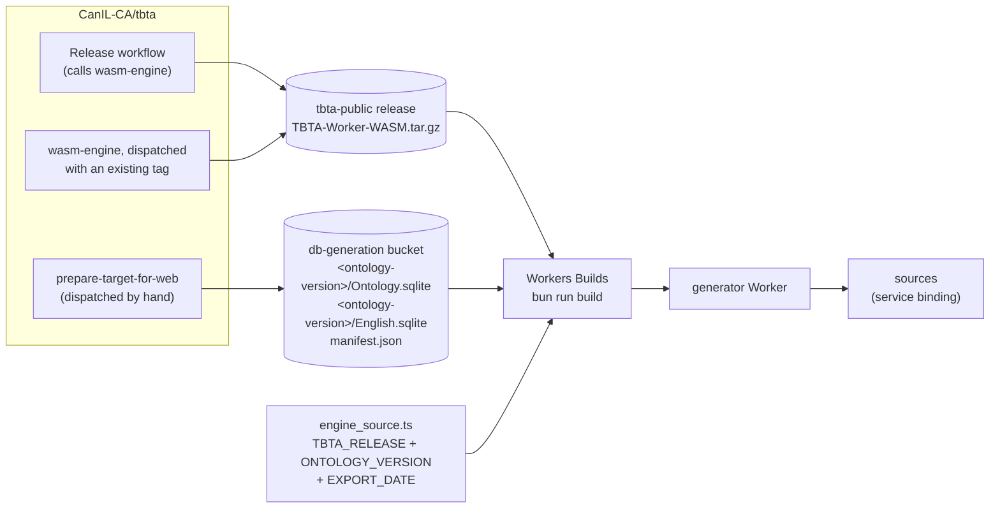

# Generator

A Cloudflare Worker that generates English verse text from a semantic encoding, using TBTA's generation engine compiled to WebAssembly. Other apps call it through a service binding; it has no public URL.

```sh
bun run dev     # downloads the engine and databases on first run, then starts the Worker
bun run build   # the same download, then a dry-run bundle; what the deploy pipeline runs
```

## Where the engine and the databases come from

Nothing is built here. [CanIL-CA/tbta](https://github.com/CanIL-CA/tbta)'s CI produces everything, and `scripts/fetch_engine.ts` downloads it into `engine/` (gitignored):

| File | Produced by | Downloaded from |
| --- | --- | --- |
| `tbta.js`, `tbta.wasm` | tbta's `wasm-engine` workflow, as `TBTA-Worker-WASM.tar.gz` | A release on [CanIL-CA/tbta-public](https://github.com/CanIL-CA/tbta-public/releases) |
| `Ontology.sqlite`, `English.sqlite` | tbta's `prepare-target-for-web` workflow | `<ontology-version>/Ontology.sqlite` and `<ontology-version>/English_<export-date>.sqlite` in the `db-generation` R2 bucket (public through its r2.dev address, declared in `tools/r2/config.ts`) |

`scripts/engine_source.ts` pins the TBTA release, the Ontology version and the export date of the English database. **To move to a new engine, Ontology or English export, change the line there and merge.** The workflow has to have prepared that combination already.

After downloading, the script checks that:

- neither database is in WAL mode (the engine opens them from an in-memory filesystem, where WAL can't work),
- the Ontology is the pinned version and English is mapped to it,
- the engine generates Genesis 1:1 from `scripts/genesis_1_1.encoding.txt`.

A failed check fails the build, so a mismatched pair can't be deployed. The script also writes gzipped copies for browsers.

## How a change reaches production



Nothing moves on its own, except the deploy after a merge. Today's steps:

| # | Step | Who | Automated? |
| --- | --- | --- | --- |
| 1 | Release TBTA: dispatch tbta's Release workflow with a tag and title. It builds the engine and attaches it to a draft pre-release on tbta-public. To attach the engine to an existing release instead, dispatch `wasm-engine` with that tag. | tbta maintainer | No |
| 2 | Publish the draft release. A draft's assets can't be downloaded anonymously. | tbta maintainer | No |
| 3 | Dispatch tbta's `prepare-target-for-web` for English, with the export's R2 path. It writes the pair and `manifest.json` to `db-generation`. | Whoever has a new export or Ontology | No |
| 4 | Set `TBTA_RELEASE`, `ONTOLOGY_VERSION` and/or `EXPORT_DATE` in `engine_source.ts` and merge. | Whoever did 1 to 3 | No |
| 5 | Workers Builds builds and deploys the generator, and sources when it imports what changed. | Pipeline | Yes |
| 6 | Prune `db-generation` after a pin bump merges: `bun run data:prune` here prints the plan, `-- --run` deletes it (see "Retention"). | Whoever bumped the pin | No |

## What needs rebuilding when

Three things get produced, and each changes for different reasons:

| What changed | Engine | Databases | Worker redeploy |
| --- | --- | --- | --- |
| Generation code in tbta (`TbtaLib`, `BrowserTest`), its sqlite, or the Emscripten build | Yes | No | Yes (new `TBTA_RELEASE`) |
| The engine's exported functions, such as `GenerateVerseFromEncoding`'s signature | Yes | No | Yes, and `src/engine.ts` has to match |
| An analyst edits English's rules, lexicon or mappings, so TBTA delivers a new export | No | Yes (prepare English again) | Yes (new `EXPORT_DATE`; the Worker bundles the pair at build time) |
| The Ontology changes (concepts, glosses) within version 3.x or 4.x | No | Yes (the Ontology, and English mapped to its version) | Yes (new `ONTOLOGY_VERSION`) |
| The Ontology reaches version 5.0.0 | Yes: the engine refuses an Ontology of 5.0.0 or later | Yes | Yes |
| A new target language | No | Yes (a new database) | Yes, and the Worker has to hold it (see "What this first version leaves out") |
| Worker code, a pin, a workspace dependency, or `wrangler.jsonc` | No | No | Yes |
| New or edited encodings in Sources, Bible text, or Sources migrations | No | No | No: the encoding arrives with each request |

How these were checked in tbta's `main`:

- **Rules are data, not engine code.** Each language database holds about thirty `Rules_*` tables (`Rules_PhraseStructure`, `Rules_Spellout`, `Rules_TenseAspectMood`, `Rules_Transfer`, `Rules_ComplexConcepts` and so on), plus its lexicon and mappings. `ExecuteRules.cpp` is the interpreter, so a rule edit reaches the generator as a new English database.
- **The engine accepts an Ontology from 3.0.0 up to, but not including, 5.0.0** (`s_verOntologyBeginSupport` and `s_verOntologyEndSupport` in `TbtaLib/src/TA1Doc.cpp`, the same library the WebAssembly build links), and refuses anything outside that range ("too old" or "too new for this version of TBTA"). The check reads the `Version` table and doesn't inspect the schema. Within the range, the Ontology's version convention carries it: MINOR for an additive schema change, MAJOR for a breaking one ([ADR 0025](../../docs/decisions/0025-ontology-d1-single-source-of-truth.md)).
- **The language database has to be mapped to the Ontology's version.** It stores that in its `OntologyVersion` table. When the Ontology is newer than the language database, TBTA runs its mapping update (`UpdateMappingsInTargetDB`), which is what the prepare workflow does for the web. This build refuses any other combination.

**What triggers a deploy.** Workers Builds builds the generator on a push to `main` that touches `apps/generator/*`, a workspace package it depends on, `package.json` or `bun.lock` (`tools/workers` derives this list). Sources watches `apps/generator/*` too, because it imports `AUDIENCES`, the engine loader and the pins (for the edit page's version label) from here. A new file in R2 or a new tbta release deploys nothing until a commit changes the pin.

**What the tbta side checks.** `wasm-engine` builds the engine with Emscripten and generates a verse with it under Node, using the pair `manifest.json` in `db-generation` points at, before it attaches anything. On a tbta pull request that touches the engine, it builds and runs that check without attaching. `prepare-target-for-web` upgrades a TBTA target export to an Ontology, trims it, and uploads both databases, then updates `manifest.json`. **It never replaces a prepared database.** Each export of a language is its own file, named by its Ontology version and the export's date (`<ontology-version>/English_<export-date>.sqlite`), so the pin names exactly what a build downloads. The date comes from the target's file name (`English_2026-11-19.tbta.sqlite`), so a file without one is refused, and a file that already exists is refused unless the workflow is run with `overwrite`. `Ontology.sqlite` is written once per version, since it's the same bytes for every language.

## Questions you might have

**How do I try generation locally?** Run the generator beside sources: `bun run dev` from the repo root starts both, or `bun run dev:generator` and `bun run dev:sources` separately. Sources' `GENERATOR` binding reaches the local Worker through wrangler's dev registry, the same way it reaches the deployed one, so the verse and edit pages generate exactly as they do in production, with the pinned engine and pair. The Worker listens on `1966`, though nothing calls it by port. If the generator isn't running, sources says so instead of generating.

**How do I test a generator change before it merges?** Locally, as above: the Worker runs whatever is in this checkout. A sources pull request's preview calls the *production* generator through its service binding, and the generator has no previews of its own, so a preview only shows a generator change if someone hand-deploys it (`bun run engine:fetch && bunx wrangler deploy` here, which replaces production until the next pipeline deploy).

**How do I roll back?** Revert the commit that moved the pin. The build downloads the older engine or pair again. The bucket keeps the current pin's files and the previous pin's (see "Retention"), so a revert of the latest pin bump always finds them.

**What breaks if tbta changes the engine's exported functions?** `src/engine.ts` calls `GenerateVerseFromEncoding` through `ccall` with a fixed argument list. If tbta changes that signature, the build's Genesis 1:1 check fails, so the change can't deploy until `engine.ts` matches.

**Why can't the build use a draft release?** tbta's Release workflow creates draft pre-releases on tbta-public, and a draft's assets can't be downloaded anonymously. Publish the release before pinning it.

**Who can write to `db-generation`?** tbta's workflows, with the `CLOUDFLARE_API_TOKEN_DB_BACKUPS` secret. The bucket is public to read through its r2.dev address. `tools/r2/config.ts` says why; [ADR 0026](../../docs/decisions/0026-generation-engine-built-in-tbta-ci.md) has the reasoning.

**Does every language need its own engine?** No. The `.wasm` is the same for every language; the databases make the difference (see below).

## Retention

Prepared files are never replaced, so `db-generation` only grows until someone prunes it. `bun run data:prune` (`scripts/prune_data.ts`) prints a plan, and `bun run data:prune -- --run` carries it out. It needs `CLOUDFLARE_ACCOUNT_ID` and `CLOUDFLARE_API_TOKEN` (the ones in `tools/r2/.env` and `.env.local` work) and the repo's full git history.

What it keeps:

- **The current pin and the previous pin.** It reads both from the commits on `origin/main` that changed `engine_source.ts`, so reverting the latest pin bump always finds its files. Before the PR that adds `EXPORT_DATE` is on `main`, read this checkout's history with `-- --ref HEAD`.
- **Anything newer than the current pin**, so an export that was prepared but isn't pinned yet isn't deleted.
- `manifest.json`.

It deletes the other dated English files and the `Ontology.sqlite` of any version no kept pin uses. Anything it doesn't recognize (another language's files, stray uploads) is listed and left alone. Run it after a pin bump merges. It isn't automatic yet: a scheduled or on-merge run is possible later, but it needs the R2 token as a secret and a full-history checkout.

## How the engine and the data fit together

The `.wasm` has no databases in it. It is the same engine whatever language or Ontology it runs against. The databases are handed to it when it starts:

1. `load_engine` (`src/engine.ts`) creates `/persist` in Emscripten's in-memory filesystem and writes each database into it as plain bytes, in `preRun`, before the engine starts.
2. The engine opens `Ontology.sqlite` and `<Language>.sqlite` from there on the first generation.

A deployed generator does run against one fixed Ontology and one fixed language database. Two things fix that pair, and neither is how the engine is compiled:

- **The language database.** tbta's workflow maps it to one Ontology version, and the engine needs it to match the Ontology it is given.
- **The Worker bundle.** `src/index.ts` imports both databases as static modules, so each deploy carries the pair pinned in `engine_source.ts`. The browser path downloads the same two files.

Running against a different Ontology or language therefore needs no rebuild of the engine. It needs a language database mapped to that Ontology's version, and a host that loads those bytes.

## API

- `POST /generate`: generates one verse.
  - **Body:** `{ book, chapter, verse, encoding, previous_encoding?, audience?, segment? }`
    - `book` is TBTA's book number (Genesis = 1, Ruth = 8, John = 43).
    - `encoding` is the verse's `semantic_encoding` from sources.
    - `previous_encoding` is the previous verse's, which the engine uses when a sentence continues across verses.
    - `audience` is 1 to 5 (default 1). `AUDIENCES` in `src/engine.ts` names them, in the order of the English database's `Properties.Audiences`; sources' panel shows those names.
    - `segment` is where generation stops: `complex_concept_insertion`, `last_structured` or `last` (default).
  - **Response:** `{ text }`, `400 { error }` for a bad request, or `422 { error, log }` when the engine produced nothing.
- `POST /warm`: loads the engine without generating anything, returns `{ ready: true }`.
- `GET /files/<name>`: the engine's files, for browsers that run it themselves: `tbta.js`, `tbta.wasm.gz`, `Ontology.sqlite.gz` and `English.sqlite.gz` (about 2.7 MB in all). Served from `engine/` as static assets, with ETags. Sources passes them on at `/generator/<name>`, and its `lib/generation/engine_worker.ts` runs the engine in a Web Worker.

## Performance (measured 2026-11-03, on an earlier build of the engine)

The first generation in a fresh Worker instance costs about 5 s of CPU on Cloudflare (about 1 s locally) while the engine loads its lexicons. Later verses take 40 to 120 ms. Calling `/warm` when a user opens a verse hides most of that wait. Memory peaked at 86 MB of the 128 MB limit.

In Chromium on a Mac, the browser engine downloaded and started in about 1 s, then generated verses offline in 30 to 370 ms, with text identical to this Worker's.

## Accuracy so far

Genesis 1:1-2 and Ruth 1:1-2 match TBTA's stored text exactly. John 3:15-16 differs from the stored text, but native `tbta_utils` produces the same text as the engine there (checked 2026-11-19 on the English export and the Ontology it was built against), so the stored text looks older than the current rules. That is a guess, and only these verses were checked.

## What this first version leaves out

| Area | Today | Not decided yet |
| --- | --- | --- |
| Ontology changes | Nothing happens until someone runs tbta's prepare workflow and bumps `engine_source.ts` | Whether and how that should be automatic. Related: [tbta#37](https://github.com/CanIL-CA/tbta/issues/37), where an Ontology update reaches every target but a target's Sample upgrade only runs when it is opened. |
| Languages | English only, fixed at deploy | Generating a verse in a target language from its encoding with that language's lexicon and rules, which is what the engine already does for English (see [ADR 0026](../../docs/decisions/0026-generation-engine-built-in-tbta-ci.md#open-questions)). Open: how many engines one Worker can hold (128 MB limit; English alone peaks at 86 MB), how a request names its language, and whether the other languages' databases are complete enough. |
| Accuracy | A handful of verses compared | A comparison against native TBTA over many verses. tbta's generation baselines (`db-classic/baseline/` in R2, checked by its `test-generation` workflow) may be the reference; they don't cover the WebAssembly build today. |
| Offline (browser) | Engine and databases download per visit, with ETags | A caching and update story, if offline use is a goal. |
| Sources panel | The "Generate English text" card on the verse page | Where generation appears in sources, and for whom. |
